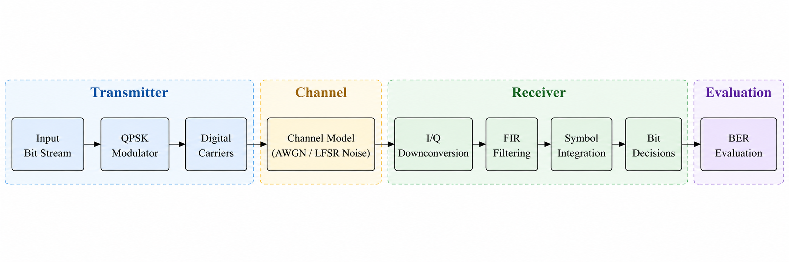

# QPSK Modulator and Demodulator with Simulated AWGN Channel

This repository contains the implementation of a Quadrature Phase Shift Keying(QPSK) system along with a AWGN channel on Spartan-7 Boolean board, along with its simulation using Python.
The project models the complete digital communication chain, from bit generation and modulation to channel simulation, coherent demodulation, bit recovery, and Bit Error Rate (BER) analysis.

## Project Context

This project was developed as part of coursework at the Indian Institute of Technology Hyderabad (IITH) to explore the design and implementation of a digital QPSK communication system.

**Course:** EE2000 - Signal Processing
## Features

- QPSK modulation and coherent demodulation
- In-phase (I) and Quadrature (Q) signal processing
- Digital carrier generation using a Numerically Controlled Oscillator (NCO)
- AWGN channel simulation
- LFSR-based noise generation
- FIR low-pass filtering using a Hamming window
- Symbol integration and bit decisions
- Bit Error Rate (BER) calculation
- Theoretical and simulated BER comparison
- Fixed-point quantization and saturation
- Hexadecimal vector export for hardware testing
- Constellation and performance visualizations
- Automated verification of the communication pipeline

## System Overview

The communication system consists of the following stages:

## Project Status

As of yet the simulation of the project has been completed in Python and are placed under the folder python_codes along with the steps to run it. 
Relevant Literature reviewed for the project has been placed under the folder Literature.
The repository also contains Preliminary Report and Mid-Term Report required for the coursework evaluation.

## Further Development Plan

We have planned to design RTL and Verilog codes to run and implement this system on FPGA. We will be using UART ports to plot constellation plot using Python.
